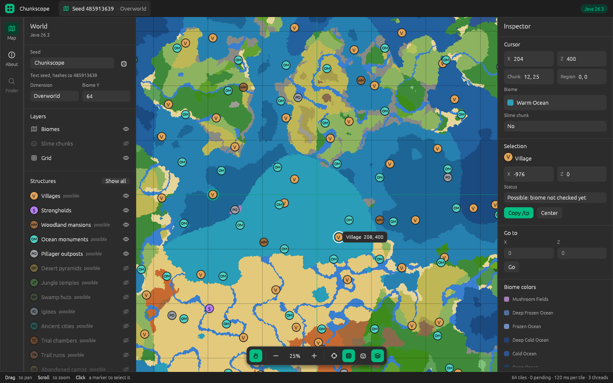
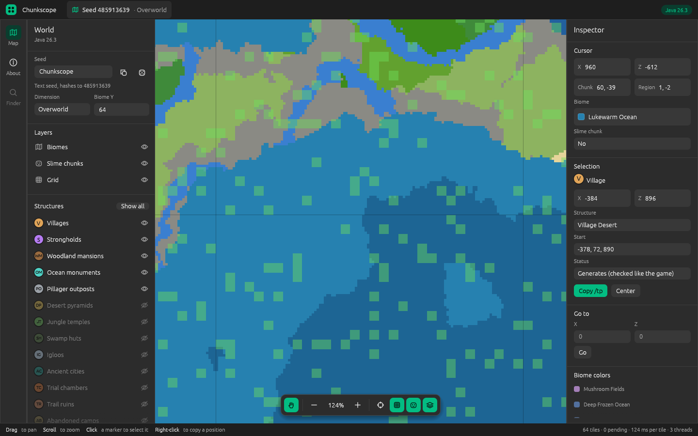
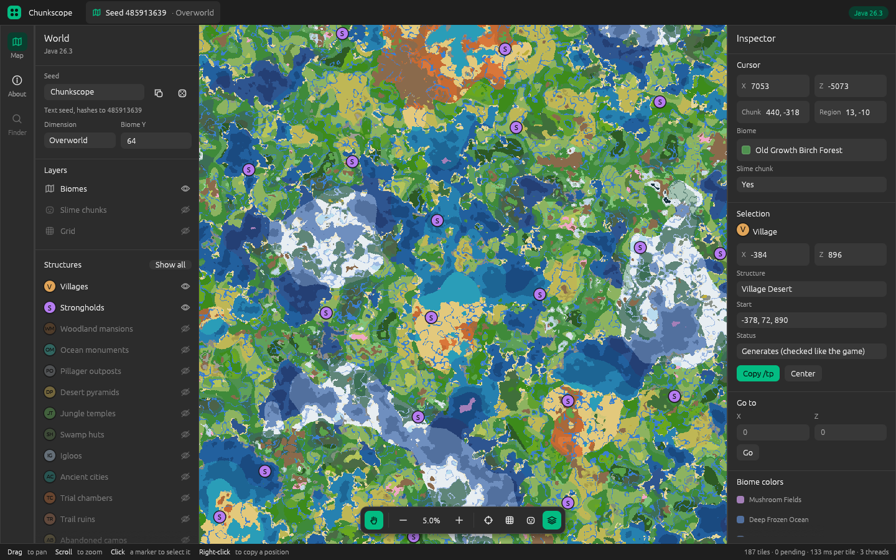

# Chunkscope

[](https://github.com/byRandom/Chunkscope/actions/workflows/ci.yml)
[](https://github.com/byRandom/Chunkscope/releases)
[](docs/PARITY.md)
[](https://www.rust-lang.org)
[](#license)

A fast, local, open-source seed map and seed finder for **Minecraft: Java
Edition**, written in Rust. Think of an offline tool that shows biomes,
structures and slime chunks for any seed, and can search millions of seeds for
the features you care about.

**Status:** early. Overworld biomes already match the game: the random
number generators, seed handling, noise, climate sampling and biome lookup
are all verified against the real JDK and the real game classes. Structure
positions match too: where each structure set attempts to generate, and
the biome and terrain checks that decide whether a structure really
generates there (all overworld structures except mineshafts and ruined
portals).

Target: Minecraft **26.3** (Java 25).



| Slime chunks, zoomed in | Strongholds, zoomed out |
| --- | --- |
|  |  |

## Goals

- **Bit-exact parity with Java Edition.** If the tool says there is a village
  at a position, there is one in the game. Every piece of logic is tested
  against an oracle (see [docs/PARITY.md](docs/PARITY.md)).
- **Local and fast.** No server, no uploads. Multi-threaded seed search.
- **Pure Rust.** No C dependencies.

Bedrock Edition is out of scope for now.

## Workspace

| Crate                  | Purpose                                                                                 |
| ---------------------- | --------------------------------------------------------------------------------------- |
| `crates/java-compat`   | Bit-exact ports of the JDK behaviour Minecraft relies on: `java.util.Random`, `StrictMath.log`, `Math.round`, `DoubleStream.sum`, `String.hashCode`, `String.trim`, `Long.parseLong` |
| `crates/mc-core`       | Minecraft logic: random sources (Xoroshiro, legacy, worldgen), noise (Perlin, normal noise, all vanilla noise parameters), overworld climate and biomes, overworld terrain (`final_density`, aquifers, heightmaps), structure placement, seed text → world seed, slime chunks |
| `crates/chunkscope-app` | The desktop app (`chunkscope`): an interactive biome and structure map, native Rust with egui |
| `parity/oracle`        | JDK oracle: reference fixtures from a real JDK                                          |
| `parity/game-oracle`   | Game oracle: reference fixtures from the real game classes (downloads the official server jar) |

## Roadmap

- [x] `java.util.Random` (including `nextGaussian` via an fdlibm port)
- [x] Seed text parsing exactly as the game does it
- [x] Slime chunks
- [x] Xoroshiro128++, `RandomSupport` seeding and positional random factories
- [x] `WorldgenRandom` decoration / feature / structure seeding
- [x] Perlin noise and normal (double-Perlin) noise, with all vanilla noise parameters
- [ ] Smeared Perlin, blended and simplex noise (terrain, End islands)
- [x] Overworld biomes (climate sampling, terrain offset spline, biome R-tree)
- [ ] Large biomes / amplified presets, Nether and End biomes
- [x] Structure placement: candidate chunks, frequency rolls, exclusion zones (all vanilla structure sets)
- [x] Strongholds (concentric rings with their biome search)
- [ ] Terrain height (needed to validate structures), in steps:
  - [x] Volume-mode noise (`NoiseStack.addToVolume`)
  - [x] Volume-mode density samplers, cell interpolation, smeared Perlin noise
  - [x] Overworld `final_density` (the game's compiled sampler tree)
  - [x] Aquifers
  - [x] Heightmaps (`getBaseHeight`: `WORLD_SURFACE_WG`, `OCEAN_FLOOR_WG`) and base block columns
- [x] Structure validation (biome and terrain height), except mineshafts and ruined portals
- [x] World spawn: the climate origin (exact) and the spawn block (estimate)
- [ ] Seed search CLI with filters
- [ ] Map viewer GUI
  - [x] Biome map (tiled, computed in parallel), structure layers, strongholds, slime chunks, grid, inspector
  - [x] Structure markers validated by biome and terrain (0.2)
  - [x] Release builds for Windows, macOS and Linux
  - [ ] Saved settings, signed builds

## Download

Prebuilt binaries for Windows, macOS and Linux are on the
[releases page](https://github.com/byRandom/Chunkscope/releases). Unpack the
archive and run `chunkscope` (`chunkscope.exe` on Windows).

The binaries are not signed yet. On Windows, SmartScreen may ask for
confirmation ("More info", then "Run anyway"). On macOS, remove the quarantine
flag first: `xattr -d com.apple.quarantine chunkscope`.

## Try it

The desktop app, from source:

```bash
cargo run --release -p chunkscope-app
```

Drag to pan, scroll to zoom, click a marker to select it, right-click the map
to copy a position or a `/tp` command. Structures are checked against biome
and terrain like the game does; mineshafts and ruined portals are not checked
yet and are marked as possible. On Linux the app needs the usual X11 or Wayland libraries
(for example `libxkbcommon-x11-0` on X11).

Command-line examples:

```bash
cargo run --release -p mc-core --example biome -- <seed> <x> <z> [y]
```

```bash
cargo run --release -p mc-core --example structures -- <seed> <x> <z> [radius]
```

```bash
cargo run --release -p mc-core --example height -- <seed> <x> <z>
```

```bash
cargo run --release -p mc-core --example spawn -- <seed>
```

## Development

```bash
cargo test
```

To regenerate the reference fixtures (requires JDK 25):

```bash
java parity/oracle/Oracle.java
```

```bash
parity/game-oracle/run.sh
```

## Versioning

Chunkscope uses [semantic versioning](https://semver.org), independent of
Minecraft's version numbers. The game version a release matches is shown in
the app and in the release notes.

- **0.x**: the parity promise is not complete yet. Each minor version is a
  milestone: 0.1 the map viewer, 0.2 structures validated by biome and
  terrain, 0.3 world spawn and the seed finder, 0.4 saved settings and signed
  builds.
- **1.0** comes when everything Chunkscope shows for the overworld (biomes,
  every structure, strongholds, spawn, slime chunks) matches the game bit for
  bit and is verified by oracle tests, with no "possible" markers left, the
  large-scale cross-check is clean, and the command line and saved formats
  are stable.
- After 1.0: patch versions fix bugs, minor versions add features or support
  for a new Minecraft version, and major versions break the command line or
  saved formats, or drop a Minecraft version.

## License

Licensed under either of

- Apache License, Version 2.0 ([LICENSE-APACHE](LICENSE-APACHE))
- MIT license ([LICENSE-MIT](LICENSE-MIT))

at your option.

Unless you explicitly state otherwise, any contribution intentionally submitted
for inclusion in this work, as defined in the Apache-2.0 license, shall be dual
licensed as above, without any additional terms or conditions.

This project is not affiliated with Mojang Studios or Microsoft. "Minecraft" is
a trademark of Mojang Synergies AB. No game code or assets are included.
