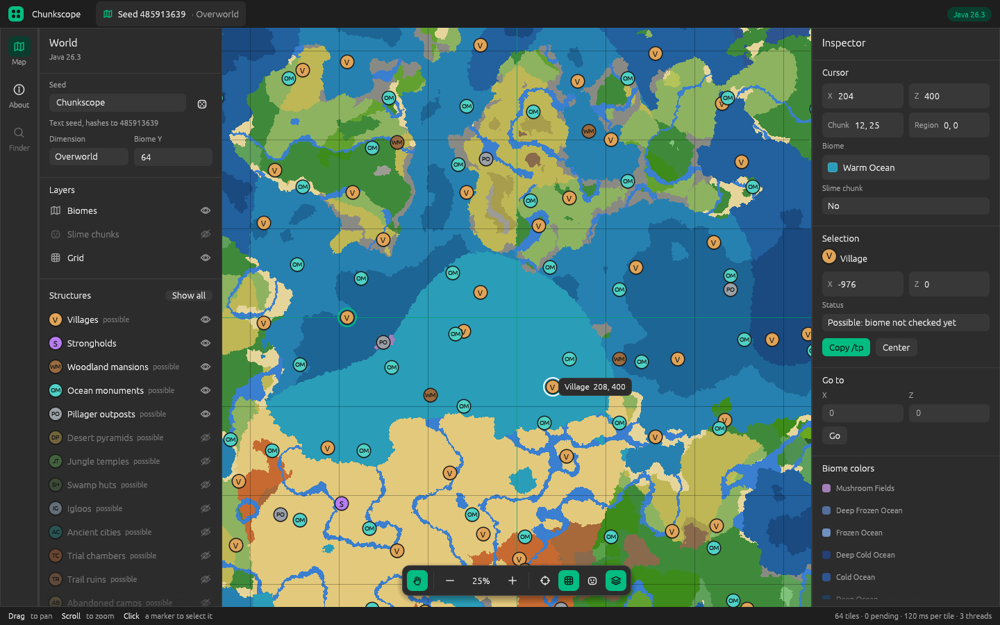

The first release of Chunkscope: a local, open-source seed map for
Minecraft: Java Edition 26.3, written in Rust.

## What's in it

- **Biome map** of the overworld for any seed (number or text, hashed like
  the game does), at any biome Y. Biomes match the game bit for bit.
- **Strongholds** at their exact positions.
- **Structure layers** for every overworld structure set. These markers are
  *possible* positions: where the game attempts a structure. Biome and
  terrain checks are not implemented yet, so some of them do not generate.
  That is the goal of 0.2.
- **Slime chunks**, chunk and region grid.
- **Inspector**: coordinates, chunk, region, biome and slime chunk under the
  cursor; the selected structure with a copyable `/tp` command; go to X/Z.

## Downloads

| Platform | File |
| --- | --- |
| Windows (x86_64) | `chunkscope-v0.1.0-windows-x86_64.zip` |
| macOS (Apple silicon) | `chunkscope-v0.1.0-macos-aarch64.tar.gz` |
| macOS (Intel) | `chunkscope-v0.1.0-macos-x86_64.tar.gz` |
| Linux (x86_64) | `chunkscope-v0.1.0-linux-x86_64.tar.gz` |

`SHA256SUMS.txt` lists the checksums. The binaries are not signed yet: on
Windows, SmartScreen may ask for confirmation ("More info", then "Run
anyway"); on macOS, run `xattr -d com.apple.quarantine chunkscope` first.
On Linux the app needs the usual X11 or Wayland libraries.
