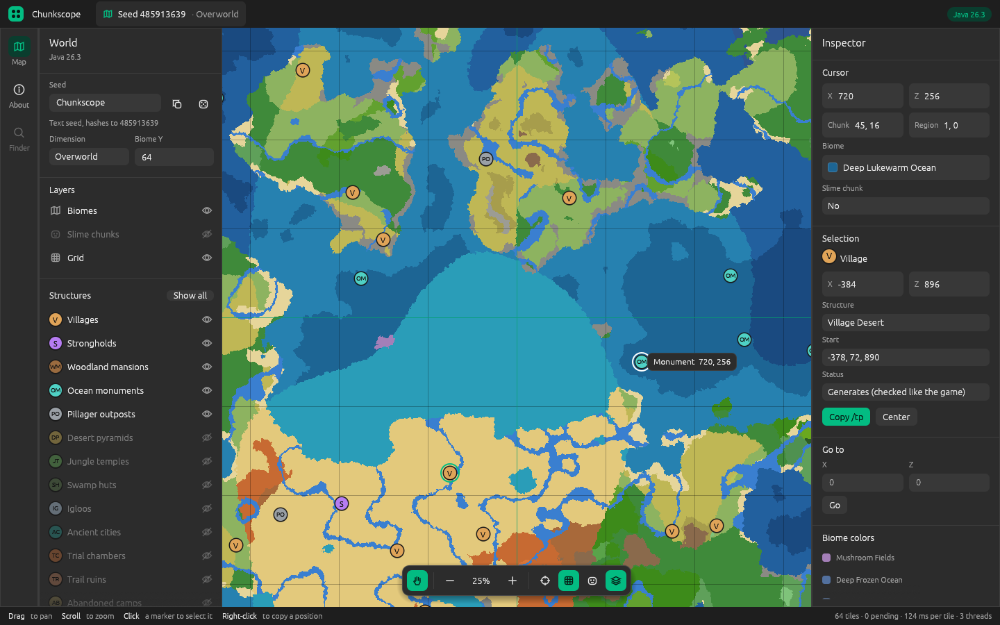

Structures are now checked against biome and terrain, exactly like the game.

## What's new

- **Structures that really generate.** In 0.1 the map showed every chunk
  where a structure set *attempts* a structure; most of those attempts fail
  in the game because of the biome or the terrain. Chunkscope now runs the
  same checks as the game: only about a quarter of village attempts and one
  in fifty mansion attempts generate, so most of the old markers are gone.
- **Which structure, and where it starts.** Selecting a marker shows the
  structure that generates (for example "Village Desert") and its start
  position.
- Validated and verified against the game for villages, pillager outposts,
  woodland mansions, ocean monuments, ancient cities, trial chambers, trail
  ruins, abandoned camps, desert pyramids, jungle temples, swamp huts,
  igloos, ocean ruins, shipwrecks and buried treasure.
- Mineshafts and ruined portals are not validated yet: they are still shown
  as possible.
- Structures are computed in the background, so the map stays smooth.

Matches Minecraft: Java Edition 26.3.

## Downloads

| Platform | File |
| --- | --- |
| Windows (x86_64) | `chunkscope-v0.2.0-windows-x86_64.zip` |
| macOS (Apple silicon) | `chunkscope-v0.2.0-macos-aarch64.tar.gz` |
| macOS (Intel) | `chunkscope-v0.2.0-macos-x86_64.tar.gz` |
| Linux (x86_64) | `chunkscope-v0.2.0-linux-x86_64.tar.gz` |

`SHA256SUMS.txt` lists the checksums. The binaries are not signed yet: on
Windows, SmartScreen may ask for confirmation ("More info", then "Run
anyway"); on macOS, run `xattr -d com.apple.quarantine chunkscope` first.
On Linux the app needs the usual X11 or Wayland libraries.
